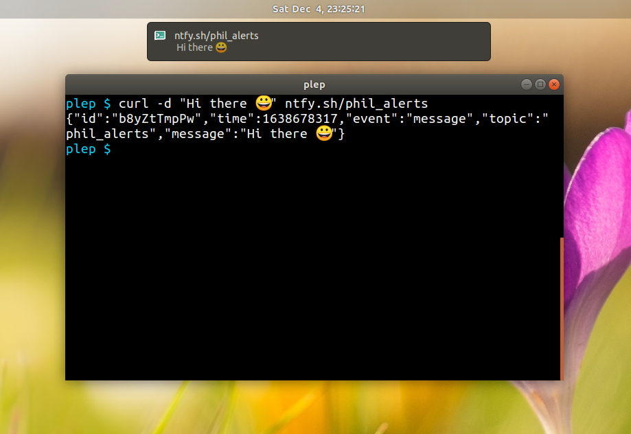
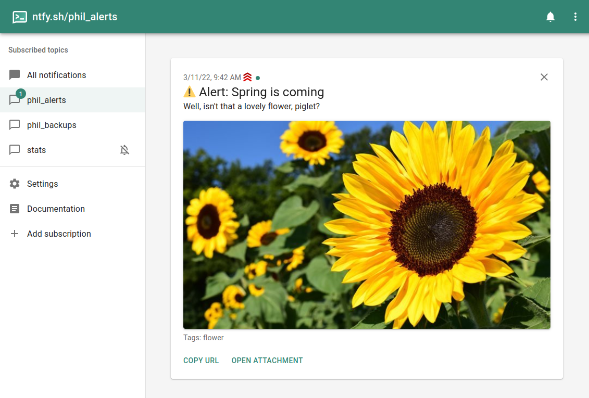
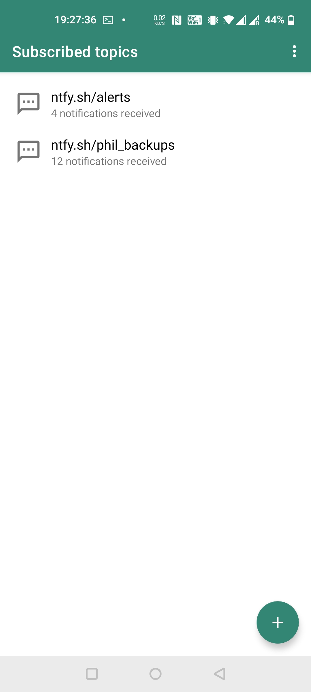
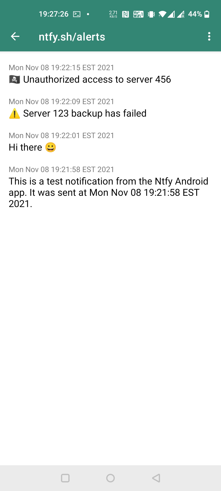
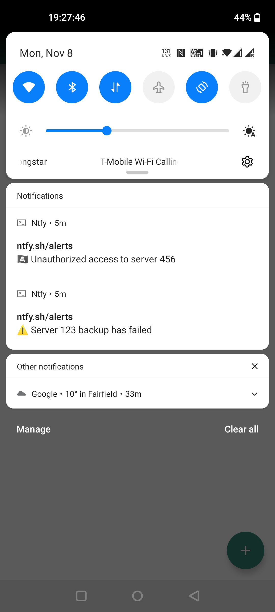

# ntfy.sh | Send push notifications to your phone or desktop via PUT/POST

**ntfy** (pronounced "*notify*") is a simple HTTP-based [pub-sub](https://en.wikipedia.org/wiki/Publish%E2%80%93subscribe_pattern) 
notification service. With ntfy, you can **send notifications to your phone or desktop via scripts** from any computer, 
**without having to sign up or pay any fees**. If you'd like to run your own instance of the service, you can easily do 
so since ntfy is open source.

You can access the free version of ntfy at **[ntfy.sh](https://ntfy.sh)**. There is also an [open-source Android app](https://github.com/binwiederhier/ntfy-android)
available on [Google Play](https://play.google.com/store/apps/details?id=io.heckel.ntfy) or [F-Droid](https://f-droid.org/en/packages/io.heckel.ntfy/),
as well as an [open source iOS app](https://github.com/binwiederhier/ntfy-ios) available on the [App Store](https://apps.apple.com/us/app/ntfy/id1625396347).

  
  
  

  
  
  
  
  

## **[Documentation](https://ntfy.sh/docs/)**

[Getting started](https://ntfy.sh/docs/) |
[Android/iOS](https://ntfy.sh/docs/subscribe/phone/) |
[API](https://ntfy.sh/docs/publish/) |
[Install / Self-hosting](https://ntfy.sh/docs/install/) |
[Building](https://ntfy.sh/docs/develop/)

## Chat/forum
There are a few ways to get in touch with me and/or the rest of the community. Feel free to use any of these methods. Whatever
works best for you:

* [Discord server](https://discord.gg/cT7ECsZj9w) - direct chat with the community
* [Matrix room #ntfy](https://matrix.to/#/#ntfy:matrix.org) (+ [Matrix space](https://matrix.to/#/#ntfy-space:matrix.org)) - same chat, bridged from Discord
* [GitHub issues](https://github.com/binwiederhier/ntfy/issues) - questions, features, bugs

## Announcements/beta testers
For announcements of new releases and cutting-edge beta versions, please subscribe to the [ntfy.sh/announcements](https://ntfy.sh/announcements) 
topic. If you'd like to test the iOS app, join [TestFlight](https://testflight.apple.com/join/P1fFnAm9). For Android betas,
join Discord/Matrix (I'll eventually make a testing channel in Google Play).

## Contributing
I welcome any contributions. Just create a PR or an issue. For larger features/ideas, please reach out
on Discord/Matrix first to see if I'd accept them. To contribute code, check out the [build instructions](https://ntfy.sh/docs/develop/)
for the server and the Android app. Or, if you'd like to help translate 🇩🇪 🇺🇸 🇧🇬, you can start immediately in
[Hosted Weblate](https://hosted.weblate.org/projects/ntfy/).

## Code of Conduct
We as members, contributors, and leaders pledge to make participation in our community a harassment-free experience for
everyone, regardless of age, body size, visible or invisible disability, ethnicity, sex characteristics, gender identity
and expression, level of experience, education, socio-economic status, nationality, personal appearance, race, caste,
color, religion, or sexual identity and orientation.

**We pledge to act and interact in ways that contribute to an open, welcoming, diverse, inclusive, and healthy community.**

_Please be sure to read the complete [Code of Conduct](CODE_OF_CONDUCT.md)._    

## License
Made with ❤️ by [Philipp C. Heckel](https://heckel.io).   
The project is dual licensed under the [Apache License 2.0](LICENSE) and the [GPLv2 License](LICENSE.GPLv2).

Third-party libraries and resources:
* [github.com/urfave/cli](https://github.com/urfave/cli) (MIT) is used to drive the CLI
* [Mixkit sounds](https://mixkit.co/free-sound-effects/notification/) (Mixkit Free License) are used as notification sounds
* [Sounds from notificationsounds.com](https://notificationsounds.com) (Creative Commons Attribution) are used as notification sounds
* [Roboto Font](https://fonts.google.com/specimen/Roboto) (Apache 2.0) is used as a font in everything web
* [React](https://reactjs.org/) (MIT) is used for the web app
* [Material UI components](https://mui.com/) (MIT) are used in the web app
* [MUI dashboard template](https://github.com/mui/material-ui/tree/master/docs/data/material/getting-started/templates/dashboard) (MIT) was used as a basis for the web app
* [Dexie.js](https://github.com/dexie/Dexie.js) (Apache 2.0) is used for web app persistence in IndexedDB
* [GoReleaser](https://goreleaser.com/) (MIT) is used to create releases
* [go-smtp](https://github.com/emersion/go-smtp) (MIT) is used to receive e-mails
* [stretchr/testify](https://github.com/stretchr/testify) (MIT) is used for unit and integration tests
* [github.com/mattn/go-sqlite3](https://github.com/mattn/go-sqlite3) (MIT) is used to provide the persistent message cache
* [Firebase Admin SDK](https://github.com/firebase/firebase-admin-go) (Apache 2.0) is used to send FCM messages
* [github/gemoji](https://github.com/github/gemoji) (MIT) is used for emoji support (specifically the [emoji.json](https://raw.githubusercontent.com/github/gemoji/master/db/emoji.json) file)
* Go's [text/template](https://pkg.go.dev/text/template) (BSD-3-Clause) is vendored under [template/gotext/](template/gotext/) with a small patch adding an execution deadline (see [template/gotext/README.md](template/gotext/README.md))
* [Lightbox with vanilla JS](https://yossiabramov.com/blog/vanilla-js-lightbox) as a lightbox on the landing page 
* [HTTP middleware for gzip compression](https://gist.github.com/CJEnright/bc2d8b8dc0c1389a9feeddb110f822d7) (MIT) is used for serving static files
* [Regex for auto-linking](https://github.com/bryanwoods/autolink-js) (MIT) is used to highlight links (the library is not used)
* [Statically linking go-sqlite3](https://www.arp242.net/static-go.html)
* [Linked tabs in mkdocs](https://facelessuser.github.io/pymdown-extensions/extensions/tabbed/#linked-tabs)
* [webpush-go](https://github.com/SherClockHolmes/webpush-go) (MIT) is used to send web push notifications
* [Sprig](https://github.com/Masterminds/sprig) (MIT) is used to add template parsing functions
